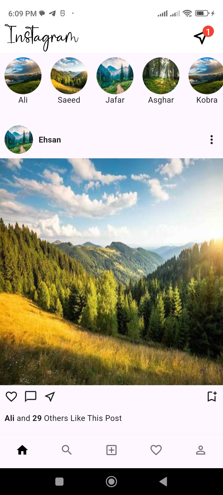
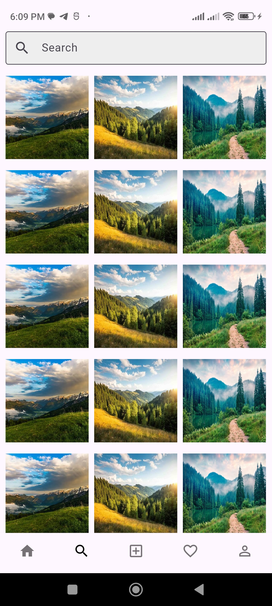
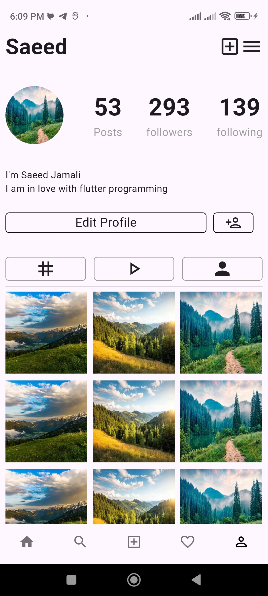

# Instagram UI Clone 📸

A Flutter-based Instagram UI clone built with Dart. This project recreates the look and feel of Instagram with a focus on UI design and navigation.

## ✨ Features

- 🏠 **Home Feed** – Instagram-style posts and stories UI
- 🔍 **Search** – Explore and search screen UI
- ❤️ **Favorites** – Favorite items UI
- 👤 **Profile** – User profile screen
- 📱 **Instagram-inspired UI** – Clean and familiar interface
- 🧭 **Navigation** – Navigate between different screens

## 📸 Screenshots

| Home Page | Search Page |
|:---:|:---:|
|  |  |

| Favorite Page | Profile Page |
|:---:|:---:|
|  |  |


## 🛠️ Built With

- Flutter
- Dart

## 📌 About

This project is a UI-only implementation inspired by Instagram. It is built for learning and practicing Flutter UI development.

**Note:** This project does not include a real backend or Instagram API integration. Features are UI demonstrations only.

## 🚀 Getting Started

1. Clone the repository:

   ```bash
   git clone https://github.com/saeid-jamali/Instagram_ui_clone.git
   ```

2. Navigate to the project directory:

   ```bash
   cd Instagram_ui_clone
   ```

3. Install dependencies:

   ```bash
   flutter pub get
   ```

4. Run the application:

   ```bash
   flutter run
   ```

## 📄 License

This project is for educational purposes.
